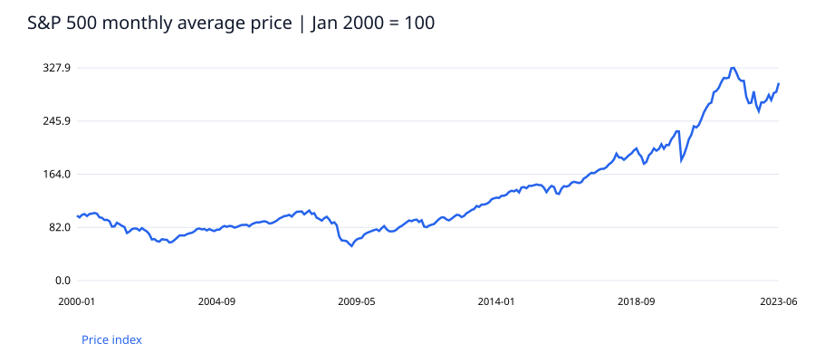
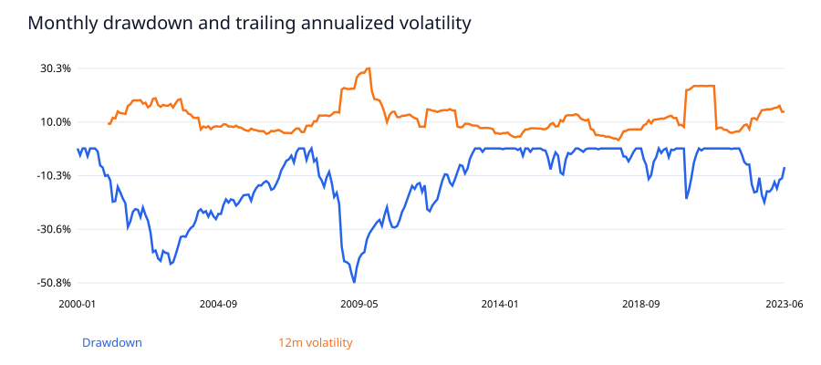

# 金融市場の収益とリスク分析

   

金融市場の価格変動とリスクを、時系列データから説明する分析です。

**分析の重点：** 時系列分析・収益率計算・リスク指標・データ品質検証

| 閲覧目的 | 成果物 |
| --- | --- |
| 結果を確認 | [主要指標](results/metrics.json) · [年別SQL集計](results/sql_result.csv) · [下落月の分析](results/worst_months.csv) |
| 分析コードを確認 | [Python](analyze.py) · [SQL](analysis.sql) |
| データの定義を確認 | [分析用CSV](data/fact.csv) · [データ辞書](data/DICTIONARY.md) |
| 再現性を確認 | [チェック結果](results/validation.json) · [依存パッケージ](requirements.txt) |
| 報告書を閲覧 | [HTMLレポート](report.html) — ダウンロード・展開後にブラウザーで開く |
| 今後のBI展開 | [Power BI構築仕様](powerbi/BUILD.md) · [DAX例](powerbi/measures.dax) — Desktop未検証 |

公開歴史データ。企業の実績や勤務先のデータを示すものではありません。

## 課題
長期の価格成長と、保有期間中の下落リスクを分けて可視化できるか。

## 分析方法
データ型・一意性・欠損・時系列を確認し、Pythonで指標を算出。SQLiteで別集計し、件数と主要指標を照合しました。処理結果は results/validation.json に記録しています。

## 主な結果
累積価格リターンは204.8%、年率換算成長率は4.9%。一方、月次観測の最大ドローダウンは-50.8%であり、成長率だけではリスクを説明できない。

## 改善提案
収益率とドローダウンを同じ画面で確認する。次の検証では配当込み指数と円換算系列を追加し、比較期間を統一する。売買判断の推奨は行わない。

## 追加の検証と解釈
最大下落のピーク月は2007-10、ボトム月は2009-03。同じ月平均価格を上回る回復月は2013-03。開始月より前の最高値は含まないため、期間に依存する。

## 解釈上の制約
2000年1月から2023年6月までの公開月次データ。月平均価格の比較であり、月末終値・日次リスク・配当込み収益ではない。手数料、税、為替を含まない。投資戦略のバックテストや将来予測は実施していない。2023年7月以降はソースの構成が変わるため分析対象外。

## 再現手順
Python 3.11以降で `python -m pip install -r requirements.txt` を実行後、`python analyze.py`。ダウンロード不要で同梱データから再現できます。固定seed=20261030。出力先は本フォルダー。分析処理は入力データを変更しません（模擬ケースのraw.csvは生成し直します）。

## 成果物
- report.html：ブラウザーで閲覧可能な分析レポート
- data/fact.csv と DICTIONARY.md：分析用データと定義
- analyze.py：生成・加工・分析・検証の実行コード
- analysis.sql と results/analysis.sqlite：実行済みSQLとDB
- charts/：SVGグラフ
- powerbi/：DAXとDesktop構築仕様（PBIX未作成）

使用技術：Python、Pandas、NumPy、SQLite、SVG。Power BIは設計のみで、実装済みスキルとしては記載していません。

## 図表プレビュー

HTMLレポートはこのリポジトリをダウンロード・展開し、`report.html` をブラウザーで開くと閲覧できます。

## 関連ポートフォリオ

- [business-process-kpi-portfolio](https://github.com/livemlife/business-process-kpi-portfolio)
- [software-quality-defect-portfolio](https://github.com/livemlife/software-quality-defect-portfolio)
